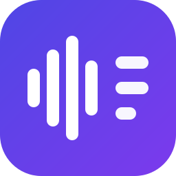

<p align="center">
  
</p>

<h1 align="center">NicelyNoted</h1>

<p align="center">
  Free meeting notes for Google Meet in Edge.<br>
  It records the call on your own PC, transcribes it locally, then hands the transcript to ChatGPT for a summary, notes and tasks.
</p>

---

Open a Google Meet call and NicelyNoted starts recording. Leave the call and a ChatGPT tab opens with your transcript attached and a prompt already sent: a short summary, key points and decisions, and a task list with owners and deadlines.

No meeting bot joins your call, nobody sees a "recording" guest, and there's no subscription. Transcription runs on your machine. The only thing that leaves it is the finished transcript, which goes to your own ChatGPT account (the free plan works).

## How it works

```
Edge extension ──start/stop──▶ recorder (your PC)            ChatGPT
 sees a Meet tab               speakers + mic → Whisper  ──▶  gets the transcript file
                               → ~/NicelyNoted/meetings/*.txt     + "summarise this" prompt
```

- **Speakers** (everyone else) and **your mic** are recorded separately, so the transcript says `Them:` and `You:`. Every other attendee is merged into `Them`; speakers are not told apart.
- Audio is cut into chunks at natural pauses (10–30 s), so sentences stay whole.
- If you're not wearing headphones, your mic hears the speakers too. NicelyNoted drops mic lines that just repeat what `Them` said.

## Requirements

- **Windows 10/11** (it records via WASAPI loopback)
- **Microsoft Edge**
- **Python 3.10+**
- An **NVIDIA GPU with about 4 GB free VRAM** is strongly recommended. It uses Whisper `large-v3`, which is accurate and fast on a GPU. Without one it falls back to `small.en` on the CPU, which is less accurate. Set `NICELYNOTED_MODEL` (e.g. `medium.en`) to choose your own model.
- A free [ChatGPT](https://chatgpt.com) account, signed in on Edge

## Install

In a normal **Windows PowerShell** window (not a terminal inside another app):

```powershell
git clone https://github.com/maan-iitd2/nicelynoted
cd nicelynoted
py -3 -m venv .venv
.venv\Scripts\python.exe -m pip install -r requirements.txt
.venv\Scripts\python.exe install.py
```

Then load the extension once:

1. Open `edge://extensions` and turn on **Developer mode**.
2. Click **Load unpacked** and choose the `extension` folder inside this repo.

The first meeting downloads the Whisper model (a couple of GB for `large-v3`), so the first transcript line is slow. After that it's quick.

## Use it

Just join a Meet call. The extension's toolbar icon shows **REC** while recording. Leave the call, or close the tab, and ChatGPT opens with your notes request already sent.

The transcript is always saved to `C:\Users\<you>\NicelyNoted\meetings\` first, whatever ChatGPT does.

To check the recorder without a meeting:

```powershell
.venv\Scripts\python.exe recorder.py --selfcheck
```

## Things to know

- **Tell people you're recording.** Many places require consent from everyone on a call. NicelyNoted doesn't announce itself, so that's on you.
- **It records the whole default speaker, not only Edge.** Pause music and other tabs during a call. If you use Bluetooth headphones, make them the default output *before* you start.
- **ChatGPT's page changes often.** The step that attaches the file and presses send is the most likely thing to break. If it does, the transcript is still on disk, and the extension's console says which step failed (see Troubleshooting).
- **Free-plan limits apply.** Very long meetings, or many uploads a day, can hit ChatGPT's own limits.
- **Only Google Meet in Edge**, and only English transcription for now.

## Troubleshooting

| Symptom | Fix |
|---|---|
| Toolbar shows **ERR**, or console says *native messaging host not found* | Re-run `install.py` from a plain Windows PowerShell window. Terminals inside packaged apps can write the registry entry somewhere Edge can't see. |
| Nothing records when you join | Open `edge://extensions` → NicelyNoted → **service worker** → Console. It logs each Meet URL it sees and whether it counted as a call. |
| Recording starts, no transcript | Read `C:\Users\<you>\NicelyNoted\host.log`. |
| ChatGPT opens but nothing is sent | Open ChatGPT's DevTools console and filter for `NicelyNoted`. The last line shows how far it got. |
| Transcript has no `Them:` lines | The call audio isn't on your default speaker. Change Windows' default output and try again. |

## Layout

```
recorder.py   speakers + mic -> chunks -> Whisper -> transcript file
host.py       lets the extension start/stop the recorder (Edge native messaging)
install.py    registers host.py with Edge
extension/    the Edge extension: detects Meet, opens ChatGPT
assets/       logo (make_logo.py draws it)
```

## Credits

[faster-whisper](https://github.com/SYSTRAN/faster-whisper) for transcription and [SoundCard](https://github.com/bastibe/SoundCard) for loopback capture.

## License

MIT, see [LICENSE](LICENSE).
